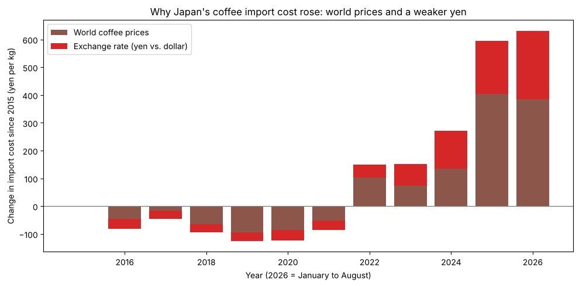

# The Weak Yen Squeeze on Coffee

**How much of the rise in Japan's coffee costs comes from world coffee prices, and how much comes from the weak yen?**

Write-up: [Why My Coffee in Okinawa Keeps Getting More Expensive](https://reycol.substack.com/p/why-my-coffee-in-okinawa-keeps-getting) (English and Japanese)

## Findings

1. **Japan's coffee import cost rose about 2.5x since 2015.** Japan paid 411 yen per kg of green coffee in 2015 and 1,007 yen per kg in 2025.

2. **About two-thirds of the increase came from world coffee prices, one-third from the weak yen.** In 2023 and 2024 the split was close to even.

| Year | Import cost (yen/kg) | Coffee market effect | Exchange rate effect |
|---|---|---|---|
| 2015 | 411 | 0 | 0 |
| 2019 | 286 | -94 | -31 |
| 2022 | 560 | +104 | +45 |
| 2023 | 563 | +74 | +78 |
| 2024 | 684 | +135 | +137 |
| 2025 | 1,007 | +403 | +193 |



3. **The yen flipped from shield to amplifier.** In 2011, a strong yen (about 80 per dollar) softened a global coffee price spike for Japan. Since 2022, a weak yen has pushed yen prices well above dollar prices.

4. **Import costs follow world prices about three months later.** Monthly changes barely correlate in the same month (0.05) but do at a three-month lag (0.39), consistent with contracts, shipping, and customs clearance.

5. **Store-bought coffee followed the import cost. Cafe coffee did not.**

| Item | Change, 2015 to 2026 |
|---|---|
| Japan's import cost | +154% |
| Coffee beans in stores | +133% |
| Instant coffee | +45% |
| Coffee at a cafe | +25% |
| All consumer prices | +15% |

When import costs fell 31% from 2015 to 2019, store coffee fell only 8%, and instant coffee rose. That fits the "rockets and feathers" pattern, though other costs like packaging and labor could explain part of it.

6. **Okinawa cafes stand apart.** A cup at a Naha coffee shop rose 19% since 2015, compared with 49% in Tokyo. The Tokyo to Naha gap grew from 57 yen to 195 yen. Store-bought beans, by contrast, ended up within about 15 yen per 100g across all four cities. The data shows the gap but not the cause. A local roaster I talked to pointed to competition: many Okinawa cafes worry that raising prices would cost them customers.

## Why this question

Coffee is a big hobby of mine. I roast my own beans and make espresso at home, and I live in Okinawa, where the cafe culture is a big part of daily life. I noticed prices climbing, but I switched to specialty coffee years ago, so my own spending couldn't tell me how much. Japan imports almost all of its coffee, priced in dollars, and since 2022 both world coffee prices and the exchange rate have moved against Japanese buyers. I wanted to separate the two.

## Data

| Source | Series | Coverage |
|---|---|---|
| [Japan Customs, Trade Statistics of Japan](https://www.customs.go.jp/toukei/info/index_e.htm) | Green coffee imports, HS 0901.11, total and by origin country | Jan 2010 to Aug 2026, monthly |
| FRED: [Arabica](https://fred.stlouisfed.org/series/PCOFFOTMUSDM), [Robusta](https://fred.stlouisfed.org/series/PCOFFROBUSDM) | Arabica (PCOFFOTMUSDM) and Robusta (PCOFFROBUSDM), IMF, U.S. cents per lb | Monthly |
| [FRED](https://fred.stlouisfed.org/series/EXJPUS) | Yen per U.S. dollar (EXJPUS) | Jan 2010 to Sep 2026, monthly |
| [Statistics Bureau of Japan, CPI](https://www.e-stat.go.jp/stat-search/files?tstat=000001243876) | Coffee item price indexes, 2025 base | Jan 2010 to Aug 2026, monthly |
| [Statistics Bureau of Japan, Retail Price Survey](https://www.e-stat.go.jp/dbview?sid=0003421913) | Store and cafe coffee prices in Sapporo, Tokyo, Kyoto, Naha | Jan 2010 to Aug 2026, monthly |

### Data quality notes

- Customs data has no ready-made time series. I pulled each month separately and checked that monthly totals match the published annual total, and that country rows sum to each month's total.
- The Arabica file starts in July 2010, so the merged table has gaps in early 2010. I kept them visible with an outer join instead of dropping months.
- Much of the e-Stat data is published only in Japanese. I translated item names, cities, and column labels to English.
- The CPI was rebased to 2025 = 100 in August 2026. I rescaled everything to 2015 = 100 for comparison.

## Approach

```
1. Ingest     Load raw CSVs, convert dates, rename columns with units, check shape, gaps, and date range
2. Analyze    Convert cents/lb to yen/kg, index to 2015, split cost change into market vs. exchange rate,
              measure lag with correlations of monthly changes, compare CPI and city prices
3. Visualize  Line and stacked bar charts in matplotlib
```

The split works by asking what Japan would have paid if the yen had stayed at its 2015 level (about 121 per dollar). The change up to that "what if" price is the coffee market effect. The gap between the "what if" price and the actual price is the exchange rate effect. The two add up to the total change.

## Repository structure

```
coffee-yen-project/
├── data/raw/                          original data, unchanged
├── notebooks/
│   ├── 01_first_look.ipynb            first exploration
│   ├── 02_coffee_yen_analysis.ipynb   full analysis, start here
│   └── fig*.png                       charts used in the write-up
└── README.md
```

## How to run

```
git clone https://github.com/reyadriancol/coffee-yen-project.git
cd coffee-yen-project
pip install pandas matplotlib jupyter
jupyter notebook notebooks/02_coffee_yen_analysis.ipynb
```

Then choose Kernel > Restart & Run All.

## Limitations

- Japan's import cost is an average across all origin countries and grades, so a shift in the mix moves it.
- Dollar import prices are estimated from yearly average exchange rates. Real shipments are paid at the rate on their own dates, and some importers hedge.
- The split depends on the baseline year. With 2021 instead of 2015, the yen's share of the 2025 increase rises from about 32% to about 39%.
- Recent Customs figures are preliminary and may be revised.
- The coffee bag size in the Retail Price Survey shrank over time, so part of the per-100g rise is shrinkflation.
- City prices come from a small number of shops. The explanations for the Okinawa gap are not tested here.

## Tools

Python, pandas, matplotlib, Jupyter
